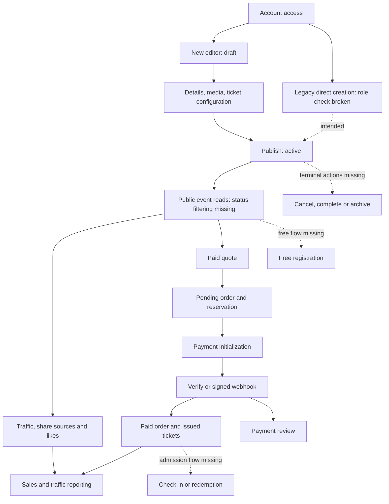
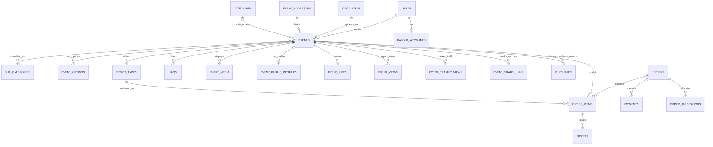

# Event lifecycle: complete backend walkthrough

Reviewed: **24 November 2026**. Repository: `kakabackend`.

This document describes the current local working copy, including existing uncommitted event-public-profile changes. It follows an event from account access and creation through discovery, sales, payment, admission, reporting, cancellation, and retention. It includes alternate implementations and unfinished stages rather than presenting one idealized flow.

The source code, route definitions, migrations, and tests are the evidence. A migration describes the schema the repository intends to create; it does not prove a deployed database has applied it. Configuration defaults are distinguished from deployment settings. No live payment or deployed environment was exercised for this review. Application behavior was not changed while writing this document.

## Contents

1. [Status labels and overall picture](#1-status-labels-and-overall-picture)
2. [People, roles, ownership, and permissions](#2-people-roles-ownership-and-permissions)
3. [Data relationships and record purposes](#3-data-relationships-and-record-purposes)
4. [Account access before event management](#4-account-access-before-event-management)
5. [The two event creation paths](#5-the-two-event-creation-paths)
6. [Draft editor payload and persistence](#6-draft-editor-payload-and-persistence)
7. [Reopening and editing an event](#7-reopening-and-editing-an-event)
8. [Categories, organizers, and venues](#8-categories-organizers-and-venues)
9. [Dates, formats, and recurring events](#9-dates-formats-and-recurring-events)
10. [Images and media lifecycle](#10-images-and-media-lifecycle)
11. [Ticket configuration, capacity, and free events](#11-ticket-configuration-capacity-and-free-events)
12. [FAQs, extra details, public profiles, guests, and crew](#12-faqs-extra-details-public-profiles-guests-and-crew)
13. [Publishing and publication validation](#13-publishing-and-publication-validation)
14. [Public discovery and event detail](#14-public-discovery-and-event-detail)
15. [Likes, older views, purchases, and recommendations](#15-likes-older-views-purchases-and-recommendations)
16. [Marketing links, public traffic, and attribution](#16-marketing-links-public-traffic-and-attribution)
17. [Paid checkout quotation](#17-paid-checkout-quotation)
18. [Order initialization and inventory reservations](#18-order-initialization-and-inventory-reservations)
19. [Order states, payment states, retries, and expiry](#19-order-states-payment-states-retries-and-expiry)
20. [Payment verification and webhook processing](#20-payment-verification-and-webhook-processing)
21. [Issued tickets, buyer access, and admission](#21-issued-tickets-buyer-access-and-admission)
22. [Seller allocations, fees, and payouts](#22-seller-allocations-fees-and-payouts)
23. [Owner dashboard and analytics definitions](#23-owner-dashboard-and-analytics-definitions)
24. [Live events, completion, cancellation, and deletion](#24-live-events-completion-cancellation-and-deletion)
25. [Database history, migrations, and seed data](#25-database-history-migrations-and-seed-data)
26. [Complete API inventory](#26-complete-api-inventory)
27. [Configuration, rate limits, errors, and operational dependencies](#27-configuration-rate-limits-errors-and-operational-dependencies)
28. [Consolidated implementation and gap register](#28-consolidated-implementation-and-gap-register)
29. [Worked lifecycle examples](#29-worked-lifecycle-examples)
30. [Verification results and source map](#30-verification-results-and-source-map)

## 1. Status labels and overall picture

| Label | Meaning in this document |
|---|---|
| **IMPLEMENTED** | The relevant code path exists and is connected to an endpoint or another active path. This is not a claim that every edge case is correct. |
| **PARTIAL** | Some pieces exist, but the feature has missing steps, inconsistent rules, or incomplete integration. |
| **BROKEN** | A concrete code defect blocks the stated behavior or produces the stated inconsistency. Where a conclusion is from source inspection rather than a runtime reproduction, that is stated. |
| **LEGACY** | An older parallel implementation remains in the repository. Legacy code can still have a live route. |
| **DATA ONLY** | Fields, models, JSON content, constants, or tables exist without the corresponding complete workflow. |
| **UNIMPLEMENTED** | No corresponding application endpoint/service/workflow was found in the reviewed repository. This describes this backend, not any external system or frontend. |
| **NEEDS VERIFICATION** | Source suggests a problem or dependency, but the affected behavior was not independently reproduced. |

The backend is a Laravel 12/PHP application using Sanctum, Socialite, Spatie Permission, and Paystack integration code. Its principal connected path is:

```text
Register/login
  -> create draft
  -> configure details, media, ticket types, and recurrence metadata
  -> publish as active
  -> public discovery and event detail
  -> traffic tracking / likes
  -> paid quote
  -> order + inventory reservation + seller allocations
  -> Paystack initialization
  -> backend verification
  -> paid order + issued tickets
  -> owner reporting
```

Free registration, recurring-occurrence generation, ticket redemption, refunds, and final payout reconciliation are not complete continuations of that path.



The event status, payment status, order status, and ticket status are different state systems. An `active` event can have failed orders. A `paid` order does not mark an event `completed`. An `ended` dashboard phase does not change the event's stored status.

## 2. People, roles, ownership, and permissions

Sources: [User](app/Models/User.php), [Organizer](app/Models/Organizer.php), [Event](app/Models/Event.php), [CreateEventController](app/Http/Controllers/Api/CreateEventController.php), [EventController](app/Http/Controllers/Api/EventController.php), [DashboardController](app/Http/Controllers/Api/DashboardController.php).

### 2.1 Account owner versus organizer

`events.created_by` references `users.id`. This is the account owner. The new editor checks it before showing an editable form, updating, or publishing. The dashboard filters and authorizes by the same field. Paid checkout snapshots it into `order_items.seller_user_id`.

`events.organizer_id` references `organizers.id`. This is the public organizer record, with a name and email. One organizer can appear on many events. The organizer is not an authenticated account and has no `user_id`, team, membership list, or login flow.

For example, user 12 can create an event displaying organizer 7, "Lagos Music Collective." User 12 owns the event and is the checkout seller. Organizer 7's name/email do not grant anyone management rights or determine payout destination.

**IMPLEMENTED:** one account owner per event. **UNIMPLEMENTED:** joint ownership, organizer account membership, organization verification, ownership transfer, delegated event management, and event invitations.

### 2.2 Access matrix

| Actor | Current capabilities and limits |
|---|---|
| Anonymous visitor | Public event/category reads, public traffic writes, paid checkout, and order read/verification with the correct checkout token. Public event visibility has gaps described later. |
| Authenticated user | Can create a draft, like events, request recommendations, and purchase. Creation does not require a special organizer role. |
| Event creator | Can reopen, edit, and publish their own draft/active event and access its dashboard/share links. |
| Different authenticated user | Cannot use the new editor or dashboard for another account's event. Matching the organizer name gives no extra rights. |
| Admin | Legacy controller intends to allow create/update/delete across events. The missing role integration blocks those checks. New editor/dashboard do not implement an admin override. |
| Agent | Legacy controller intends to allow create/update across events. Delete is only intended for admin or creator. Agent is a global role check, not an event assignment. |
| Buyer | Accesses their linked order through authentication or through possession of its checkout token. Buying does not grant event editing. |
| Seller | A user referenced by an order item's `seller_user_id`, obtained from the event's creator at checkout. There is no separately assigned seller role. |
| Guest/host/crew/producer | Public profile labels stored as JSON. These are presentation content and grant no permission. |
| Check-in staff or collaborator | No implemented event membership/permission workflow found. |

### 2.3 Role infrastructure: PARTIAL / BROKEN

Spatie Permission is installed. Configuration and migrations define `roles`, `permissions`, `model_has_roles`, `model_has_permissions`, and `role_has_permissions`. Teams are disabled in the checked-in permission configuration.

However, `User` uses `HasFactory` and `Notifiable` only. It does not use `Spatie\Permission\Traits\HasRoles`, and no local `hasAnyRole()` implementation was found. The legacy event controller nevertheless calls that method before create/update/delete. From source inspection, those authenticated requests fail at the missing method before reaching their intended permission decisions.

For update/delete, being the creator does not avoid the problem: the role expression is evaluated before the owner alternative.

No role-assignment call during registration, role/permission seeder, role-management API, or event-specific role policy was found. `AuthServiceProvider` has no event policy mapping. The Google callback reads `$user->role`, while the user migration has no `role` column; this is not a functioning role source.

These distinctions matter: tables for roles do not establish a working role workflow, and JSON crew roles do not connect to those tables.

## 3. Data relationships and record purposes

### 3.1 Relationship map



This diagram shows conceptual relationships. For example, draft category/creator IDs are nullable in later migrations even though normal API-created events have an authenticated creator. Not every reverse relationship has an Eloquent method.

### 3.2 Main event fields

| Field/group | Meaning and current handling |
|---|---|
| `id` | Numeric primary key. API event binding uses this; there is no stored slug field. |
| `title`, `description` | Main event text. New service applies its simple text-stripping function. |
| `created_by` | Owner account. Preserved during new-editor updates. |
| `organizer_id`, `address_id`, `category_id` | References to supporting records; category can be null for drafts. |
| `date`, `ends_at`, `event_timezone` | Start, optional end, and timezone metadata. `date` has a datetime cast; `ends_at` does not. |
| `event_type`, `recurrence_data` | One-time/recurring classification and recurrence JSON. |
| `event_format`, `meeting_link` | In-person/online/hybrid selection and online link. |
| `price` | Listing price; new flow computes the minimum submitted tier price, not the checkout authority. |
| `total_tickets` | Configured admission capacity in the new flow, not a live remaining-stock counter. |
| `ticket_mode` | Free or paid. Database default is `free`. |
| `status` | `draft`, `active`, `cancelled`, or `completed`; database default is `active`, while the new service explicitly creates drafts. |
| `featured`, `duration` | Older listing fields; the new save flow resets these to false and null respectively. |
| `main_image`, `banner_image`, `banner_url` | Overlapping old/new image representations. |
| `organiser_website`, `tags` | Event-level strings; tags are not normalized tag records or a many-to-many relationship. |
| `attendee_fields`, `extra_details` | JSON configuration/content stored by the new editor. |
| timestamps | Record creation/update times, not event start/end or payment times. |

The `Event` model's `$fillable` remains limited to the older event fields. The new service writes newer fields with `forceFill()`. Do not assume calling ordinary `Event::create()` with every new field has the same effect as using the editor service.

Only `date`, `price`, and `featured` are explicitly cast on `Event`. Event JSON fields are manually encoded/decoded by the editor; public event serialization can expose them as JSON strings. The separate public profile does cast its JSON fields to arrays.

### 3.3 Supporting records

| Record/table | Purpose |
|---|---|
| `users` | Authentication and event ownership; also buyers and sellers through references. No convenience event/likes/purchases relationships are declared on the current User model. |
| `organizers` | Name/email; shared public identity without account membership. |
| `event_addresses` | Venue, address lines, city, state, postal code, country. |
| `categories` | One primary category per event; name-based matching in the new editor. |
| `sub_categories` / `event_sub_category` | Independent subcategory labels and their event associations. No category parent field. |
| `event_options` / `event_event_option` | Reusable named options and their event associations; `is_custom` marks custom options. |
| `ticket_types` | Configured ticket products, capacities, prices, sales windows, visibility, purchase limits, and unit/admission semantics. |
| `faqs` | Legacy relational questions/answers. |
| `event_media` | Ordered cover/secondary URLs with source metadata. |
| `event_public_profiles` | Optional rich public content; unique `event_id` gives at most one per event. |
| `event_likes` | User-event favorites; a unique user/event constraint prevents duplicate rows. |
| `event_views` | Legacy authenticated views used by recommendations. |
| `event_traffic_views` | New visitor-based hourly traffic and marketing source data. |
| `event_share_links` | Per-event source code/label definitions; unique event/source pair. |
| `purchases` | Legacy user/event purchase data used by recommendations; not the new checkout ledger. |
| `orders` | Customer identity, cart fingerprint, access token hash, totals, reservation and payment state. |
| `order_items` | One line per purchased ticket type; event, seller, product, price, and attribution snapshots. |
| `payments` | Multiple possible gateway attempts for an order; unique reference and optional provider transaction ID. |
| `tickets` | Issued admission credentials, each attached to an order item, event, and ticket type. |
| `order_allocations` | Per-order/per-seller financial allocation snapshots. |
| `payout_accounts` | At most one record per user, with provider subaccount and activation state. |

## 4. Account access before event management

**IMPLEMENTED:** email/password registration and login, session logout, current-user retrieval, password recovery, and Google OAuth controller/routes.

Email registration validates a name, unique email, and confirmed password of at least eight characters, creates a user, logs them in, and regenerates the session. No organizer/agent/admin role is assigned. Login uses `Auth::attempt()` and regenerates the session. This backend's login response returns a user and message, not a newly minted personal access token.

Sanctum's configured guard is `web`; the bootstrap API middleware includes stateful frontend handling. For the intended cookie-based frontend flow, CSRF/session cookies, credentialed requests, recognized frontend domains, and CORS configuration all matter. Event editor/dashboard routes require `auth:sanctum`; they do not require verified email or a particular role.

Logout clears the web session and Sanctum's cached user. Password recovery sends a frontend reset URL; the reset endpoint validates a token and confirmed password, saves the hash, rotates the remember token, and emits the password-reset event. These are account recovery operations, not event notifications.

**PARTIAL / BROKEN:** the current User model also lacks Sanctum's `HasApiTokens`. The dashboard tests use `Sanctum::actingAs()` and fail on `withAccessToken()`. This does not establish that cookie-authenticated requests all fail; other tests authenticate through ordinary Laravel `actingAs()` and pass. No personal-token issuance API was found.

**PARTIAL:** Google callback persistence is inconsistent with the current User `$fillable`: `google_id`, `avatar`, and `email_verified_at` are passed to `updateOrCreate()` but are not fillable. The callback also replaces the password with a random hash when updating a matching account and reads a nonexistent role attribute. The Google redirect flow should not be described as verified end-to-end by the event tests.

Sources: [AuthController](app/Http/Controllers/Api/AuthController.php), [PasswordResetController](app/Http/Controllers/Api/PasswordResetController.php), [Sanctum configuration](config/sanctum.php), [bootstrap](bootstrap/app.php).

## 5. The two event creation paths

| Aspect | New editor flow | Older direct event flow |
|---|---|---|
| Route | `POST /api/create-event` | `POST /api/events` |
| Controller | `CreateEventController` | `EventController` |
| Access | Any authenticated user | Intended admin/agent; missing role method currently blocks it |
| Starting state | Explicitly `draft` | Relies on database default `active` |
| Input | Camel-case JSON/editor fields | IDs, nested organizer/location, ticket types, file uploads |
| Category | Resolve existing category name | Validate existing category ID |
| Organizer/location | Reuse or create by name/venue | Create new organizer and address |
| Images | Base64 or HTTP/HTTPS URL | Required uploaded main/banner files |
| Tickets | Free or paid; table/individual editor fields | At least one ticket type; older fields |
| Capacity and headline price | Computed | Submitted independently |
| FAQs/options/subcategories | Not synchronized by this service | Created/attached during direct creation |
| Recurrence/online format | Stored/configured | Not populated by the older create method |
| Publication | Separate publish action | No separate publish action |

The newer flow is more complete for staged editing and commerce configuration. The older route is still registered; it has not been removed or made an alias of the new service.

### 5.1 Older direct-create details: LEGACY / BROKEN

After the broken authorization check, the intended flow validates title length 5-100, description length 20-5000, category ID, organizer name, a full location, a date after today, price, capacity, main/banner images, and one or more ticket types. Files must be JPEG/PNG/GIF, each no more than 5120 KB. It supports up to five subcategories, FAQ pairs, and option names.

Inside a transaction it stores image paths, creates organizer/address/event rows, attaches subcategories, creates ticket types and valid FAQ pairs, and creates or attaches custom option records. It responds with an event ID. Database/storage exceptions inside its try/catch return a 500 response containing the exception message. The authorization call is before that try/catch.

Additional mismatches remain even after restoring roles: it does not set `ticket_mode = paid`, so database defaults classify the event as free despite submitted priced tiers; it does not create new media records; it stores independent event price/capacity rather than deriving them; and it directly accesses optional `organizer.email` and `duration` keys without fallback values. These are source findings, not a successful runtime execution of this blocked path.

## 6. Draft editor payload and persistence

Source: [CreateEventService](app/Services/CreateEventService.php), especially `saveEvent()`, and [CreateEventController](app/Http/Controllers/Api/CreateEventController.php).

### 6.1 Input-to-storage map

| Editor field | Storage / behavior |
|---|---|
| `title`, `description` | Stripped text in event columns |
| `category` | Existing category name -> `category_id` |
| `organiser` | Reused/new organizer -> `organizer_id`; fallback name `Unknown Organiser` |
| `organiserWebsite` | `organiser_website` |
| `venue` | Reused/new address -> `address_id` |
| `format` | `event_format`; default `in-person` |
| `meetingLink` | `meeting_link` |
| `startsAtLocal`, `endsAtLocal` | Parsed with `timeZone` into `date` and `ends_at` |
| `startsAt`, `endsAt` | Fallback parse inputs when local values are absent/empty |
| `timeZone` | `event_timezone`; default `Africa/Lagos` in service |
| `eventType` | `event_type`; default `one_time` |
| `recurrence` | Encoded `recurrence_data` for a recurring event; otherwise encoded null |
| `tags` | One stripped string |
| `coverImage` | Processed into `main_image` and a cover media row |
| `secondaryImages` | Ordered media rows; first image also feeds `banner_url` |
| `ticketMode` | `ticket_mode`; default `free` |
| `freeCapacity` | `total_tickets` for free mode |
| `tickets` | Ticket-type synchronization for paid mode |
| `attendeeFields` | JSON text in `attendee_fields` |
| `extraDetails` | JSON text in `extra_details` |

The controller allows partial draft content: most fields are nullable. A nearly empty draft can therefore exist, with empty title/description, no date/category/image, default organizer, and an empty venue record. A draft is a saved work item rather than a complete sellable event.

### 6.2 Save sequence

1. Validate draft input rules in the controller.
2. Begin a database transaction in the service.
3. Fetch the existing event or construct a new one.
4. Refuse an existing event whose status is outside `draft`/`active`.
5. Resolve supporting records and image inputs.
6. Build an explicit event-data array; the client cannot assign arbitrary event columns merely by adding `created_by` or `status` to its JSON.
7. Preserve an existing creator/status; otherwise use the authenticated user and `draft`.
8. Save via `forceFill()`.
9. Synchronize ticket types, removing or hiding omitted types as appropriate.
10. Delete current media rows and create cover/secondary rows again.
11. Return a freshly loaded event. The controller returns ID, status, and title, with a message and HTTP 201 for creation.

The service itself does not check that the caller owns an existing ID; the HTTP controller performs ownership authorization. Internal callers must preserve that boundary.

### 6.3 Validation and persistence limits: PARTIAL

Draft validation allows title and ticket names up to 200 characters, organizer names up to 200, and venue strings up to 500. Original migrations define event title 100, ticket name 50, organizer name 100, and venue name as a default-length string. No widening migration for these was found. On a database enforcing those widths, validation can succeed while persistence fails; SQLite tests do not establish compatibility with those production limits.

Local date inputs and timezone are validated as strings, not as actual local-datetime/timezone values at the draft-rule stage. Parsing can therefore throw instead of returning a clean field-specific validation error. Some strings are nullable in validation while later conversion assumes usable formats.

`strip()` removes script blocks and angle brackets, then trims. It is not a complete rich-text sanitizer, and nested JSON content is not all passed through it. The imported `AntiXSS` in the older controller is unused.

## 7. Reopening and editing an event

**IMPLEMENTED:** `GET /api/create-event/{id}` looks up the event, checks creator ownership, rejects statuses outside draft/active, and builds a frontend-shaped `form` response. It loads category, organizer, address, ticket types, and media. Times are formatted as local strings; ticket types include their IDs and current settings.

**IMPLEMENTED:** `PATCH /api/create-event/{id}` validates submitted draft rules and performs `array_replace(existingEditorPayload, requestData)`. Omitted top-level fields retain the current editor representation. Arrays are replaced as whole arrays, not deeply merged by ticket ID or attendee-field ID.

Examples:

- Sending only `venue` retains title and tickets.
- Sending `tickets: []` removes all incoming paid tiers; historical ones are hidden and unused ones deleted.
- Sending one tier in `tickets` does not mean "edit only this tier"; every omitted tier goes through removal/hiding logic.
- Sending `secondaryImages: []` clears secondary media rows.

For active events, `publishedPayloadErrors()` validates the merged payload before saving. Successful edits keep status `active`; there is no unpublished revision, approval queue, change history, or rollback endpoint. `created_by` is preserved. `featured` is reset false and `duration` null by the new service even when editing an event that previously had values from the legacy path.

**PARTIAL:** there is no optimistic version check or explicit event-row lock in editor saving, so simultaneous edits can overwrite each other's data. Active ticket capacity/price/window changes are not coordinated with the inventory locks used during checkout. The editor does not reject capacity below units already sold or reserved. Order snapshots preserve already-created purchase prices and product descriptions.

**LEGACY / BROKEN:** `PUT /api/events/{event}` has its own update path and missing role method. If its authorization were repaired, it updates a narrower set of main event fields and subcategories; it does not synchronize organizer/address, FAQs, options, tickets, media, recurrence, or the newer publication rules. It also lacks the new controller's draft/active state restriction.

## 8. Categories, organizers, and venues

**IMPLEMENTED:** categories and subcategories are publicly listed. No category/subcategory management API was found. Seeders populate starting data.

New category resolution trims/lowercases the input and matches `LOWER(name)`. It returns null when unmatched, allowing the draft to save but preventing publication. Duplicate names are not prevented by a database unique constraint in the original category schema.

New organizer resolution matches names case-insensitively and otherwise creates a record with a null email. It is a lookup convenience, not verified organization ownership. Organizer names are not unique in the schema, so concurrent creates or prior duplicate records can make reuse ambiguous. The legacy path always creates an organizer; email is unique when provided, which can conflict on reuse of an existing email.

New address resolution matches `venue_name` directly. It does not compare full address details, coordinate venues by geography, or attach ownership. A new row gets empty street/city/state/postal values and country `Nigeria`, including for online events or incomplete drafts. Two different venues sharing the same name can be conflated by this lookup.

Subcategories are attached through `event_sub_category`. Event options use `event_event_option`. The new editor does not synchronize either. No separate options-listing/management route was found. Tags remain an unrelated string; there is no tag-search/filter route in the event controller.

## 9. Dates, formats, and recurring events

### 9.1 One-time dates and timezone: PARTIAL

The service prefers `startsAtLocal`/`endsAtLocal`, parsed with format `Y-m-d\TH:i:s` and the supplied timezone. If empty, it parses `startsAt`/`endsAt` as fallback values. Ticket sales windows use the same local-first approach. The service defaults to `Africa/Lagos`; the application configuration's timezone is `UTC`.

The editor returns local datetime strings. The dashboard converts dates to an event timezone and falls back to Lagos for an invalid timezone. These are different conversion paths: the dashboard explicitly treats stored strings as UTC, while the save service does not explicitly convert parsed local objects to UTC before persistence. Combined with the missing `ends_at` cast, this is a **NEEDS VERIFICATION** timezone round-trip issue. No dedicated test asserts preservation of an exact instant across editor save/reopen/dashboard display and database engines.

Draft validation does not enforce future dates, end-after-start, or a valid timezone identifier. Active-edit validation checks end-after-start only when local start/end values are both available. Initial publishing does not perform that comparison or require an end time. The older direct-create path separately requires a date after today.

### 9.2 Event format: IMPLEMENTED configuration / PARTIAL access flow

| Format | Publication requirement |
|---|---|
| `in-person` | Venue |
| `online` | Meeting link |
| `hybrid` | Venue and meeting link |

These choices do not introduce separate attendance or check-in systems. Meeting links are validated as strings, not by a URL rule. The public event response does not protect the link behind a purchase or registration check.

### 9.3 Recurrence: DATA ONLY / PARTIAL

The editor accepts:

| Field | Accepted configuration |
|---|---|
| `frequency` | `daily`, `weekly`, or `monthly` |
| `weeklyDays` | Array of integers 0-6 |
| `monthlyMode` | `day_of_month` or `nth_weekday` |
| `dayOfMonth` | Integer 1-31 |
| `nthWeekday.ordinal` | Integer 1-5 |
| `nthWeekday.weekday` | Integer 0-6 |
| `seriesEndType` | `on_date` or `after_occurrences` |
| `seriesEndDate` | Date |
| `occurrenceCount` | Integer at least 1 |

For `eventType = recurring`, the service stores the recurrence object without expanding or transforming it. The test explicitly checks storage without transformation. Publication only requires `frequency` and `seriesEndType`; it does not enforce every conditional detail, such as an end date for `on_date` or a count for `after_occurrences`.

**UNIMPLEMENTED:** occurrence generation, event-occurrence tables, per-date capacities or ticket selection, recurrence calendars, skipped dates, exceptions, individual-occurrence rescheduling/cancellation, series-wide updates, and tickets bound to an occurrence. Orders and tickets currently reference the single event ID.

## 10. Images and media lifecycle

### 10.1 New editor: IMPLEMENTED with gaps

`handleImage()` accepts base64 strings prefixed with JPEG/JPG/PNG/WEBP/GIF image data headers. It decodes bytes, chooses an extension, writes a UUID filename under `events/images` on the public disk, and returns the disk URL. It also accepts HTTP/HTTPS strings unchanged. Other strings yield an empty result.

The cover becomes `main_image` and a media row with `is_cover = true`, order zero. Secondary images receive increasing sort order. The first secondary image is processed separately for `banner_url`; `banner_image` is set null.

**PARTIAL:** the first base64 secondary image is processed once for `banner_url` and again in the media loop, creating two physical files for that input. Uploaded images returned as HTTP/HTTPS disk URLs are classified as `external_url` by `createMedia()` because it infers source type from the resulting URL. That metadata therefore does not reliably identify original uploads.

**PARTIAL:** base64 validation checks decoding and the claimed prefix, not decoded image MIME/dimensions. HTTP/HTTPS input is not fetched or checked for an actual image. The public disk's `put()` result is not checked. Request string-length limits do not constitute image-content validation.

### 10.2 Older image path: LEGACY

The old create/update methods use Laravel uploaded-file image validation and store relative paths in `main_image`/`banner_image`. The new flow stores URLs. There is no shared image accessor that normalizes both response formats.

### 10.3 Replacement and removal: PARTIAL

New saves delete/recreate media database rows but do not delete replaced physical image files. Old update deletes the previous main/banner path when replacing it, but assumes those values are relative disk paths; newer events can contain URLs. Event deletion only attempts main/banner file deletion, not every secondary image or `banner_url` asset.

Filesystem writes/deletes are not rolled back by a database transaction. A failed save can leave uploaded files, and deleting an old file before a database failure can leave a record pointing to a removed asset.

The public disk configuration maps `storage/app/public` to an application `/storage` URL and defines a public-storage symlink. Correct deployment of that mapping and `APP_URL` is necessary; it was not verified on hosting.

## 11. Ticket configuration, capacity, and free events

Sources: [TicketType](app/Models/TicketType.php), [CreateEventService](app/Services/CreateEventService.php), [InventoryService](app/Services/Commerce/InventoryService.php).

### 11.1 Editor ticket fields

| Input | Stored field / behavior |
|---|---|
| `id` | Reuse the ID only if it belongs to this event; otherwise make a new tier |
| `name` | Tier name, stripped |
| `unitType` | `individual` or `table`; defaults individual |
| `color` | Display string; default `#ec4899` |
| `price` | Decimal tier price |
| `units` | `quantity`, the configured number of products |
| `peoplePerUnit` | `people_per_unit`, at least one; default one |
| `maxPerPerson` | Optional purchase quantity cap |
| `visible` | Whether offered publicly; defaults true |
| `perks` | Tier description |
| `salesStartLocal` / `salesStart` | Sales-start datetime |
| `salesEndLocal` / `salesEnd` | Sales-end datetime |

The service sets `is_featured = false`. Ticket type `quantity` is capacity, not remaining inventory.

### 11.2 Units versus people

For individual tiers the event capacity computation adds `units`. For table tiers it adds `units * peoplePerUnit`.

Example: 100 individual units plus 10 tables for 10 gives 110 sellable products and 200 configured admissions. Buying two tables issues two tickets, each with admission count 10. It does not issue 20 individual tickets or assign seats.

The event's headline price is the minimum over submitted tiers. That calculation does not filter hidden tiers, future-sales tiers, or sold-out tiers. Listing price is therefore not necessarily the cheapest ticket currently purchasable.

**PARTIAL edge cases:** if `peoplePerUnit` is omitted for a table, event capacity calculation uses zero, while tier saving defaults to one. If an individual tier is given a value greater than one, event capacity counts only units but checkout/ticket/dashboard can use the larger admission count. There is no cross-field consistency rule enforcing the intended semantics.

### 11.3 Ticket edits and historical preservation

Incoming IDs are matched only within the event's ticket collection, preventing an ID from another event from being edited through this synchronization. A foreign/unknown supplied ID becomes a new tier rather than an error.

After saving incoming tiers, omitted existing tiers are checked for either legacy `Purchase` or new `OrderItem` history. Historical tiers are set invisible; unused tiers are deleted. Even an unpaid historical order item preserves the tier. This protects order foreign keys and snapshots.

Switching to free mode treats the incoming tier list as empty and follows the same hide/delete logic. It does not refund buyers or invalidate issued tickets. For a free-mode event with older paid history, some dashboard sales/capacity fields and historical revenue can consequently describe different aspects of the same event.

**PARTIAL:** no rule prevents lowering capacity below commitments, changing unit/admission semantics after sales, or defining sales windows after event end. The `maxPerPerson` limit is applied to the current checkout line, not cumulatively across a person's previous orders; a guest can place multiple orders.

### 11.4 Free events: DATA ONLY beyond publication

Free mode saves a capacity and a zero event price; the ordinary new-save path has no incoming ticket types. Free events can be drafted, published, viewed, liked, and tracked.

**UNIMPLEMENTED:** free RSVP/registration, attendee count updates from registrations, free ticket issuance, confirmation, cancellation of an RSVP, waitlist, and attendance conversion. Paid checkout explicitly refuses free events and zero-priced tickets. Dashboard free-event sales tracking is marked unsupported and reported as zero sold/reserved with configured capacity available.

## 12. FAQs, extra details, public profiles, guests, and crew

### 12.1 Three separate content mechanisms

| Mechanism | Current write/read behavior |
|---|---|
| Relational `faqs` | Legacy create can create question/answer rows; public detail loads them. New editor does not synchronize them. |
| `extra_details` | New editor stores an array of type/label/value content. It is not automatically converted into FAQ rows or public-profile sections. |
| `event_public_profiles` | Separate optional rich-content record; public detail loads it, but no profile-writing endpoint was found. |

These mechanisms coexist. Updating one does not automatically update the others.

### 12.2 Public-profile fields: IMPLEMENTED read / DATA ONLY authoring

The profile contains `summary`, `caption_title`, `caption_description`, `organiser_bio`, `organiser_image`, and JSON arrays `guests`, `schedule`, `moments`, `faqs`, `crew`, and `related_event_ids`.

It has one unique event reference and cascades when that event is deleted. Arrays have model casts. The public event read returns `public_profile: null` when absent and does not seed/create it. Tests cover both populated and absent profiles.

Guest and crew content can contain a `role` string such as Host or Producer. That is descriptive text; there is no link to a user ID, permission assignment, event invitation, or Spatie role. Public-profile schedule content likewise does not schedule jobs or generate recurring occurrences. Moments are content URLs, not an upload workflow of their own.

The event detail resolves `related_event_ids` into a separate `related_events` collection, excludes the current event, and restricts those related records to active status. It selects basic event fields with organizer/address. Missing/non-active IDs do not resolve. Array order is not explicitly preserved, and the stored ID array is not a relational foreign-key association.

**UNIMPLEMENTED:** owner-facing profile create/update API, nested profile validation/authorization, guest/crew invitation or account access, profile version history, and schedule-driven operations. Existing profile content can be created through internal/database/model operations, as the tests demonstrate.

## 13. Publishing and publication validation

Source: `CreateEventController::publish()` and `publishedPayloadErrors()`.

**IMPLEMENTED:** `POST /api/create-event/{id}/publish` requires authentication, an existing event, creator ownership, and stored status `draft`. It reads persisted data rather than saving the publish request body. A frontend must save changes before calling publish. Success force-fills `status = active` and returns an event summary. It does not create a public profile, tickets for buyers, share links, occurrences, or notification jobs.

### 13.1 Exact readiness differences

| Rule | Initial publish | Saving an already-active event |
|---|---|---|
| Nonempty title | Required | Required |
| Start date/time | Required | Required |
| End date/time | Not required | Required |
| End later than start | Not checked | Checked when both local datetime values are available |
| Future event | Not checked | Not checked |
| Category | Non-null stored category ID | Nonempty category name in merged payload |
| Cover | `main_image` or a cover media row | Nonempty `coverImage` string in merged payload |
| In-person/hybrid venue | Venue row with nonempty name | Nonempty venue string |
| Online/hybrid link | Nonempty meeting-link string | Nonempty meeting-link string |
| Paid ticket types | At least one stored tier | At least one submitted/merged tier |
| Tier names | Nonempty | Nonempty |
| Tier price | Nonnegative | Nonnegative |
| Positive ticket quantity | Not required | Not required |
| A currently visible/sellable tier | Not required | Not required |
| Complete recurrence | Only frequency and series-end type required | Same limited presence checks |
| Attendee definitions or organizer website | Not required | Not required |

**BROKEN / PARTIAL consistency:** a published event without an end time can later fail a small unrelated edit because the active-edit rules now require the end. A paid event can publish with zero-priced, hidden, or zero-quantity tiers yet have no ticket that checkout will sell. Active-edit category validation checks text before resolution, so a nonempty but unknown category name can pass that check and be saved as a null category ID by the service.

When status is not draft, publish responds 422 with "Event is already published," including statuses cancelled/completed. That message is broader than the actual state distinction.

**UNIMPLEMENTED:** publish approval, moderation, scheduled publication, unpublish/revert-to-draft, private/invite-only event visibility, preview tokens, publication revisions, publish audit history, and automatic attendee notifications after important edits.

## 14. Public discovery and event detail

Source: [EventController](app/Http/Controllers/Api/EventController.php), `index()` and `show()`.

### 14.1 Event list: IMPLEMENTED / PARTIAL visibility

`GET /api/events` loads category, organizer, address, and subcategories. Its supported inputs are:

| Query | Effect |
|---|---|
| `category_id` | Match primary category |
| `subcategory_id` | Match a linked subcategory |
| `date_from`, `date_to` | Inclusive start-date bounds |
| `featured` | Apply featured-only condition when the input evaluates truthy |
| `sort=date-asc` / `date-desc` | Order by event start |
| `sort=price-asc` / `price-desc` | Order by event headline price |
| Missing/unrecognized sort | Newest-created first |
| `page`, `per_page` | Pagination; default page size 10, capped above at 100 |

The JSON has event items in `data`, pagination values in `meta`, and first/last/previous/next links in `links`. The controller logs query counts and supplied filters.

No full-text title/description search, geographic/radius lookup, tag filter, price-range filter, format filter, or availability filter is implemented here. Query parameters do not have dedicated validation; `per_page` is capped above but not explicitly validated as a positive integer. Boolean filtering uses PHP truthiness rather than a dedicated normalized boolean rule.

### 14.2 Event detail: IMPLEMENTED

`GET /api/events/{event}` uses numeric model binding and loads public profile, media, category, organizer, address, subcategories, visible ticket types, relational FAQs, and event options. It adds calculated `available_quantity` to each visible tier and resolves active related events from profile IDs.

Visible tiers are returned even if their sales window has not opened, has closed, or their available quantity is zero; checkout performs further eligibility checks. The response's configured `quantity` remains unchanged, alongside the calculated availability.

Public detail does not automatically record a traffic view. The frontend must call the tracking endpoint separately. It also does not automatically create a profile or seed fallback content.

### 14.3 Public exposure: BROKEN / PARTIAL

Neither the main list query nor `show()` requires `status = active`. There is also no model global active-only scope. Draft/cancelled/completed rows are consequently eligible for public reads if present. Related-event lookup and traffic tracking do apply active status checks, so the boundary is inconsistent across endpoints.

The controllers return Eloquent event data directly without an explicit public resource allowlist. The Event model has no hidden list for `meeting_link`, creator reference, internal configuration, or recurrence JSON. Organizer email is also an ordinary serializable organizer attribute. There is no paid-attendee-only meeting link, private draft preview, or public/private field split.

The dashboard builds frontend paths like `/events/42-lagos-music-night`, but the backend event route uses the numeric event model key. No custom route-key slug parsing is implemented in this model/controller. A frontend using those paths must extract the ID before its API request; the generated path is not evidence that the API accepts that full slug.

## 15. Likes, older views, purchases, and recommendations

Sources: [EventLike](app/Models/EventLike.php), [EventView](app/Models/EventView.php), [Purchase](app/Models/Purchase.php), [RecommendationEngine](app/Services/RecommendationEngine.php), [RecommendationController](app/Http/Controllers/Api/RecommendationController.php).

### 15.1 Likes: IMPLEMENTED with access/cache gaps

`POST /api/events/{event}/toggle-like` requires authentication. It deletes an existing user/event like or creates one, then returns `liked`, event-wide `likes_count`, and a message. A newly created like clears that user's recommendation cache; removing a like does not clear it through this branch.

`GET /api/events/{event}/check-liked` is also behind authentication middleware. Its controller has an anonymous fallback response, but middleware normally rejects an anonymous request before that fallback can run.

`GET /api/user/liked-events` finds liked IDs, loads category/address/ticket types, and returns an unpaginated latest-first list. **BROKEN:** the route does not require authentication while the controller dereferences `$request->user()->id`. Its query does not restrict event status or visible ticket types. Like/check-like themselves do not require the target event to be active.

### 15.2 Older view collection: LEGACY

`EventController::trackView()` and `EventView::trackView()` support authenticated user views, deduplicated within a rolling prior hour and storing the IP address. However, the registered `/events/{event}/track-view` route now points to `EventTrackingController`, which writes the newer `event_traffic_views` table. The older method is not the target of that route.

The dashboard-foundation migration imports historical older views into the new traffic table. That is a migration-time import, not ongoing bidirectional synchronization. It cannot manufacture historical guest traffic that never existed.

### 15.3 Older purchases: LEGACY / DATA ONLY purchasing API

`Purchase` stores user, event, optional ticket type, quantity, decimal total, payment method, transaction ID, and pending/completed/cancelled/refunded status. It has completed/user/event scopes and simple completion/cancellation helpers. No current purchase-create endpoint was found. New checkout does not call `Purchase::create()` or synchronize paid orders into this table.

Recommendations and ticket-removal safeguards still query it. Thus it remains relevant even though it is not the new commerce transaction source. Purchase recommendation queries do not consistently restrict to completed purchases; any stored status can contribute to purchased/preferred event IDs.

### 15.4 Recommendations: IMPLEMENTED / PARTIAL integration

| Group | Current logic |
|---|---|
| `because_you_liked` | Find categories from legacy purchases and likes; recommend future active events in those categories with positive event capacity, excluding legacy purchased IDs. |
| `jump_back_in` | Find previously viewed events through `event_views`, newest view first; restrict to future active events with positive event capacity and exclude legacy purchased IDs. |
| `made_for_you` | Score up to three categories by purchases (10), likes (5), and old views (1); recommend future active events excluding previously interacted IDs, prioritizing featured/date. |

Each group has a label, count, and up to ten formatted events. Empty preference/history yields empty groups rather than a general trending fallback. The capacity filter uses configured `events.total_tickets`, not checkout availability, so a sold-out event can still qualify. Price formatting hardcodes `$` even though commerce defaults to NGN.

The cache key includes the user and current hour. `CACHE_TTL = 30` is passed as the cache duration, while response metadata says "30 minutes"; in this Laravel cache API that numeric duration represents 30 seconds. There is an explicit authenticated clear-cache endpoint.

**PARTIAL:** current tracked views do not feed old `event_views`, and current paid orders do not feed `purchases`. New purchases can remain eligible for recommendation and new views may not populate "Jump back in." The category score uses joins across multiple interaction collections, so multiple rows can multiply contributions; treat the weights as implemented query behavior rather than a verified statistical model.

## 16. Marketing links, public traffic, and attribution

Sources: [EventTrackingController](app/Http/Controllers/Api/EventTrackingController.php), [EventAttributionService](app/Services/Dashboard/EventAttributionService.php), dashboard-foundation migration.

### 16.1 Source definitions and link management

| Label | Code |
|---|---|
| WhatsApp | `wa` |
| Instagram | `ig` |
| Direct link | `direct` |
| X / Twitter | `x` |
| Facebook | `fb` |
| LinkedIn | `in` |
| Email | `email` |

Defaults are created lazily when dashboard/share-link logic asks for them, or when tracking uses a valid built-in source. Merely publishing does not eagerly create them.

An owner can create a custom source with a 2-60 character label. The service strips tags/trims, slugifies the label, truncates the base, and adds a random suffix on collision. Codes are unique per event. Share-link responses return labels, codes, flags, and statistics, not a complete redirect/short-link endpoint.

**UNIMPLEMENTED:** source-link edit/delete endpoints, scheduled campaigns, promotional discount codes, affiliate commission, and a server redirect that automatically records a visit. A source code tracks attribution; it is not a coupon or staff permission.

### 16.2 Recording a view

`POST /api/events/{event}/track-view` is public. For an existing non-active event it returns `{ "ok": true }` without recording. A nonexistent event still fails model binding. For active events it requires `visitor_id` as a UUID and accepts optional `source_code` with letters/numbers/underscore/hyphen up to 32 characters.

The service lowercases/trims and SHA-256 hashes the visitor ID. IP and user-agent values are stored as keyed hashes rather than raw values in the new traffic table. A view is identified by event, visitor hash, and the start-of-hour bucket. This is a calendar-hour deduplication rule, different from the older rolling-hour check.

If the same hourly row later has an authenticated user, the service can fill its missing user ID. If a different valid tagged source arrives, it replaces source code and refreshes `viewed_at`. A direct untagged visit does not erase the existing tagged source. Unknown well-formed source codes resolve to null rather than creating arbitrary custom sources.

The frontend must generate/persist the visitor UUID and send it. The backend does not create the visitor identifier or derive it from an account. Clearing/changing that ID changes the measured visitor. These are visitor-identifier metrics, not a guaranteed unique-human count.

### 16.3 Conversion attribution

At order initialization, optional `visitor_id` is hashed and saved on the order. The service finds the latest non-null tagged source for each cart event during the previous 30 days, then snapshots its `source_code` and traffic-view ID on that event's order item.

A multi-event order can therefore credit event A to Instagram and event B to WhatsApp. Attribution comes from server-stored views, not a price/commission parameter on the checkout item. Without a matching tagged view, the purchase is unattributed. Source is fixed at initialization; a later click does not rewrite an already-created order item through this path.

## 17. Paid checkout quotation

Sources: [QuoteCheckoutRequest](app/Http/Requests/QuoteCheckoutRequest.php), [CheckoutService](app/Services/Commerce/CheckoutService.php), [Money](app/Support/Money.php).

**IMPLEMENTED:** `POST /api/checkout/quote` is available to guests and logged-in users. It accepts 1-25 item entries, each with a distinct existing integer `ticket_type_id` and quantity 1-20. Duplicate type IDs are rejected instead of automatically combined.

Items are normalized and sorted by ticket type ID. The service loads ticket types and their events and evaluates every requested line. Eligibility requires:

1. An existing type and event.
2. Event `status === active`.
3. Event `ticket_mode === paid`.
4. A visible tier.
5. A non-null event creator.
6. An open sales window, when start/end windows exist.
7. Requested quantity no greater than available capacity or `max_per_person` for the line.
8. A strictly positive tier price.

If any line fails, it throws field errors and returns no valid cart quote through this path. Client-submitted event titles, prices, line totals, seller IDs, and currencies do not override the database-derived line values.

Money is converted into integer minor units with two decimal places. For NGN, a price of 8,000.00 becomes 800,000 minor units. Line total is unit price times product quantity; a table's price is per table, not multiplied again by its number of people.

The quote returns currency, subtotal, zero discount, total, and event/product/seller snapshots for each line. Currency is global configuration, not per-event or mixed-currency checkout. No tax, coupon, discount calculation, dynamic buyer service fee, or currency conversion is implemented.

**PARTIAL:** quote is not a reservation; capacity can change before initialize, which checks again. There is no explicit event start/end cutoff in `buildQuote()`. An ended event that remains active with no closed tier sales window can still qualify. `maxPerPerson` is a per-line limit, not a lifetime identity-based limit.

## 18. Order initialization and inventory reservations

### 18.1 Request and idempotency

`POST /api/checkout/initialize` accepts quote-shaped items plus a required UUID `checkout_token`, optional UUID `visitor_id`, and customer first name, last name, RFC-valid email, and phone. Maximum lengths are 100/100/255/50 for those customer fields. The phone is a string, without a regional phone-number verification flow.

The service trims customer fields, lowercases email, normalizes/sorts items, hashes the checkout token, and computes a cart/customer fingerprint. Only the token hash is stored. A cache lock keyed by that hash has a 20-second lease with a six-second blocking wait.

If an order with that token hash exists, the fingerprint must match; otherwise initialize returns a validation error about a different cart/customer. A matching retry continues the existing order. This makes the token an attempt identifier and guest access secret. It is separate from `visitor_id`, which is analytics identity.

### 18.2 New-order transaction

For a new attempt, the service:

1. Sorts ticket type IDs and locks their rows with `lockForUpdate()`.
2. Rebuilds the quote under those locks and checks inventory again.
3. Resolves per-event source attribution.
4. Creates an order with a ULID public ID, token hash, fingerprint, optional authenticated buyer ID, customer data, totals, pending status, and expiry.
5. Creates one order item per ticket type with current event/title/name/unit/price/seller snapshots.
6. Creates seller allocation rows grouped by seller account.
7. Creates a payment attempt with reference `KT-` plus a ULID.
8. Commits the transaction, with up to three transaction attempts as configured in that call.
9. Calls Paystack outside the database transaction so the gateway call does not hold inventory row locks.

Default reservation duration is 20 minutes, with an enforced minimum of five for the configured value. A single order can cover multiple events and sellers. The database enforces a unique order/ticket-type pair and unique checkout-token hash.

### 18.3 Inventory definition

```text
occupied units = quantity on paid orders
               + quantity on pending_payment orders whose expires_at is in the future

available units = max(0, configured tier quantity - occupied units)
```

`InventoryService::reservedQuantities()` includes both sold units and active unpaid holds despite its method name. It can exclude one order during late-payment evaluation.

No mutation decrements ticket-type `quantity` or event `total_tickets` on sale. Inventory is derived from orders. Expired, payment-failed, review, cancelled, and refunded order states are excluded from the occupied-unit query.

An expired pending row stops blocking availability as soon as its timestamp passes, even if no cleanup job changes its status string. No scheduled expiry sweeper was found. A read-only order request also does not mark it expired; an initialize retry can do so.

### 18.4 Concurrency limits

The new initialization path explicitly locks affected tier rows in deterministic order. This is an implemented oversell safeguard among participating paths. However, SQLite tests do not prove MySQL/PostgreSQL production locking semantics, editor writes do not take those same inventory locks, and some retry paths reuse existing snapshots without re-quoting. These are boundaries on the safeguard, not a claim that all checkout races are solved.

## 19. Order states, payment states, retries, and expiry

Sources: [Order](app/Models/Order.php), [Payment](app/Models/Payment.php), `CheckoutService::continueExistingOrder()`.

### 19.1 Order states

| State | Meaning and current producers |
|---|---|
| `pending_payment` | Newly initialized order or retry reset; reserves inventory while unexpired. |
| `paid` | Successful backend-verified payment; issued tickets become visible to authorized buyer. |
| `payment_failed` | Gateway initialization failure or recognized failed/abandoned/reversed provider result when the order is not already paid. |
| `expired` | Existing-order initialization retry after expiry marks this state; timestamp alone already releases a pending hold. |
| `payment_review` | Amount/reference/currency mismatch or unfulfillable late success. |
| `cancelled` | Constant/state handling exists, but no cancellation endpoint was found. |
| `refunded` | Constant/state handling exists, but no refund workflow was found. |

### 19.2 Payment-attempt states

| State | Meaning |
|---|---|
| `created` | Local attempt created before gateway initialization |
| `initialized` | Gateway returned accepted reference/access code |
| `success` | Verified matching successful charge |
| `failed` | Gateway init failed or recognized unsuccessful provider status |
| `review` | Verification mismatch, extra successful payment, or unfulfillable late charge |

Order status is the overall transaction state. Payment status belongs to an attempt; an order can have several attempts, including one successful attempt and a second charge flagged for review.

### 19.3 What initialize retries do

| Existing order condition | Behavior |
|---|---|
| Paid, payment-review, cancelled, or refunded | Return current order/latest payment payload; do not start another attempt in this branch. |
| Expiry is past | Save `expired`, then reject with 422 requiring a new checkout token. |
| Latest payment initialized with an access code | Reuse its existing payment details. |
| Order payment-failed and not expired | Reset to pending-payment. |
| No payment, or latest payment failed/review | Create another local payment attempt and initialize it. |
| Other current attempt | Try gateway initialization for that attempt. |

Gateway initialization errors record payment failure and order payment-failed, save a truncated response message, then rethrow. The outer controller does not convert every exception to a custom 422; framework exception handling determines the final error response.

**NEEDS VERIFICATION:** failure releases the hold because inventory ignores payment-failed orders; retrying a not-yet-expired order reuses its snapshot and resets pending status without a new locked inventory quote. Another buyer could have used the released capacity. The existing tests cover a basic retry but not that competing-buyer scenario.

**UNIMPLEMENTED:** abandoned-cart email, explicit cancel-checkout endpoint, extend-reservation endpoint, dashboard review-resolution workflow, and automated charge reconciliation worker.

## 20. Payment verification and webhook processing

Sources: [PaystackService](app/Services/Commerce/PaystackService.php), [PaystackWebhookController](app/Http/Controllers/Api/PaystackWebhookController.php), [PaymentFinalizer](app/Services/Commerce/PaymentFinalizer.php).

### 20.1 Gateway initialization

The gateway payload uses the order customer's email, order total in minor units, currency, local payment reference, a frontend callback `/payment-success/{orderPublicId}`, and metadata with the order ID. Optional dynamic split data can be included. A secret key is required from service configuration; no secret value is included in this document.

The service uses a three-second connection timeout and ten-second total timeout for initialization. It checks successful HTTP/API status, a string access code, and that the returned reference matches the local attempt. Authorization URL is stored if supplied. Verification uses the provider's reference endpoint with an eight-second timeout.

The frontend success page or redirect is not the payment authority. Ticket issuance happens only through the backend finalizer after verification.

### 20.2 Buyer-triggered verification

`POST /api/checkout/payments/{reference}/verify` finds the payment/order, checks buyer/token access, calls Paystack verification, and passes the verified provider data into the finalizer. It returns the authorized public order shape.

### 20.3 Webhook

`POST /api/payments/paystack/webhook` computes HMAC-SHA512 of the raw request body with the configured secret and compares it to `x-paystack-signature`. Missing configuration yields 500; a bad signature yields 401.

A correctly signed non-`charge.success` event, missing reference, or unknown reference is acknowledged with `{ "ok": true }` and no finalization. For a known successful-charge event, the handler still calls the provider verification endpoint; it does not trust webhook `data` alone. It then uses the same finalizer as the browser verification path.

The route excludes generic API throttling, applies its dedicated webhook limiter, and is exempt from CSRF in bootstrap. It runs synchronously. There is no durable webhook inbox, queue-based processing, replay browser, or event-ledger table. A provider/network/finalization exception can propagate so a successful acknowledgement is not sent; no local scheduled retry worker was found.

### 20.4 Finalization decision sequence

1. Lock payment and order rows in a database transaction.
2. If this payment is already success and order paid, return existing data immediately.
3. For provider statuses failed/abandoned/reversed, save attempt failure and mark the order payment-failed if not already paid. Other non-success statuses return existing state.
4. For success, compare reference exactly, amount as minor-unit integer, and currency case-insensitively to the local attempt.
5. On mismatch, put the attempt in review and, unless already paid, the order in payment-review; issue no tickets.
6. If another attempt already paid the order, flag only this extra successful attempt for review; do not issue another set.
7. Load order items and lock all affected tier rows in sorted order.
8. Evaluate provider payment time against reservation expiry.
9. If fulfillable, mark payment success, order paid, and issue missing tickets up to each item's quantity.
10. Return fresh order/items/tickets/payments/allocations. The transaction call allows three attempts.

### 20.5 Late payment versus late notification

If Paystack's `paid_at` is before or equal to expiry, the finalizer honors the payment even if the webhook/verification request reaches the backend later. If `paid_at` is absent, it uses current time. If actual payment is after expiry, it rechecks available units excluding this order while tier locks are held. Missing tier or insufficient capacity moves payment/order to review with a reason and issues no tickets for the order.

Late rechecking is about capacity; it does not rerun all current quote rules such as event-active status, visibility, or sales windows. Similarly, the finalizer has no complete guard that rejects every manually cancelled/refunded order before processing a success. Cancellation/refund integration must therefore be designed before adding those operations elsewhere.

**PARTIAL:** review is recorded, not automatically resolved/refunded. Provider reversal handling is not a refund/chargeback lifecycle; the early already-paid return and limited webhook event handling do not implement later financial reversal reconciliation.

## 21. Issued tickets, buyer access, and admission

### 21.1 Ticket creation: IMPLEMENTED

One ticket is issued per purchased unit, using the order item's saved fields. For quantity two of a ten-person table product, two credentials each admit ten. The ticket contains:

- A ULID `public_id`.
- References to order item, event, and ticket type.
- A random 48-character token, encrypted through the model cast.
- A SHA-256 `token_hash` with a uniqueness constraint.
- `admit_count`, at least one, from the purchase snapshot.
- Status `valid` and issuance time.

The finalizer counts existing item tickets and creates only the remainder up to quantity. Payment/order locks and successful-payment checks provide idempotency in the implemented path. The raw token is decrypted for the authorized buyer payload, not included in public event data.

### 21.2 Order access and payload: IMPLEMENTED

`GET /api/checkout/orders/{publicId}` looks up the public ID and authorizes either the user matching non-null `order.user_id` or a supplied `X-Checkout-Token` whose SHA-256 matches the stored hash. The same access rule protects browser-triggered payment verification. Public ID alone is insufficient.

The order payload includes public ID, status, currency, subtotal/discount/total, expiry/payment times, item event/title/ticket/unit/quantity/price snapshots, and ticket data only when order status is paid. Ticket objects expose public ID, token, admission count, and status. A pending/review order returns empty ticket arrays through that serializer.

A guest order does not become linked to a newly logged-in matching-email account automatically. Access is based on the stored user ID or token, not matching the email alone. No "my orders," "my tickets," guest order recovery, or buyer resend endpoint was found.

### 21.3 Attendee data: DATA ONLY configuration / UNIMPLEMENTED answers

The editor can define attendee fields with ID, label, enabled, and required flags. Checkout collects only one fixed customer object. There is no attendee-answer table or request validation enforcing the event's custom field definitions, and no per-ticket named attendee records. A table can admit multiple people without storing their identities.

### 21.4 Admission and delivery: UNIMPLEMENTED

No ticket scan/redeem/check-in endpoint, staff permission, used-ticket transition, partial table admission counter, check-in audit log, or offline scanner synchronization was found. The token hash supplies a possible future lookup mechanism, but no code currently consumes it for admission.

No ticket QR rendering, PDF download, wallet pass, confirmation/ticket email, attendee reminder, transfer/resale, name change, ticket reissue/revocation, seating map, seat assignment, or attendance export workflow was found. These are absent backend workflows; a frontend could render a token as a QR, but that would not add server-side redemption protection.

## 22. Seller allocations, fees, and payouts

Sources: `CheckoutService::createAllocations()`, [OrderAllocation](app/Models/OrderAllocation.php), [PayoutAccount](app/Models/PayoutAccount.php), [PaystackSplitService](app/Services/Commerce/PaystackSplitService.php), [commerce configuration](config/commerce.php).

### 22.1 Allocation calculation: IMPLEMENTED

Items are grouped by `seller_user_id`, which was copied from `events.created_by`. Each seller gets an allocation snapshot for the whole order, including multiple events they own.

```text
gross_minor = sum of that seller's line totals
fee_bps = configured fee, clamped to 0..10000
platform_fee_minor = floor(gross_minor * fee_bps / 10000)
seller_net_minor = max(0, gross_minor - platform_fee_minor)
```

For example, a configured 500 basis points is 5%. On 20,000.00 NGN gross, the allocation records 1,000.00 platform fee and 19,000.00 seller net before any separate gateway-fee implications. The code default is zero platform fee; this is a configuration default, not a verified deployed commercial rate.

An active payout account, if found, contributes its ID and provider subaccount code. New allocations initially have settlement mode `platform_held` and settlement status `pending`. These rows are created before the order is paid; allocation presence alone does not prove revenue was collected.

### 22.2 Dynamic split: IMPLEMENTED conditionally

The split builder returns no split if dynamic splits are disabled, there are no positive-net allocations, or any positive-net seller lacks a subaccount code. Otherwise it builds a flat Paystack split with net minor-unit shares and configured bearer type. After initialization, all order allocations are marked `paystack_split` or `platform_held` based on whether that split was used.

The organizer's displayed name/email is not the payout recipient identity. Revenue belongs to the creator-account snapshot. There is no endpoint to transfer that ownership relationship.

### 22.3 Payout lifecycle: PARTIAL / DATA ONLY

The payout-account model defines pending/active/disabled states and stores provider, subaccount, account name, bank name, and last four account digits. There is one payout account per user in the schema.

**UNIMPLEMENTED:** bank lookup/account verification API, subaccount creation/onboarding, owner payout-account management API, withdrawals, payout scheduling, post-event release, settlement webhook reconciliation, marking allocations settled, fee refunds, chargeback accounting, and seller financial statements. A dynamic-split request is not proof that the provider actually completed settlement, and `platform_held` is an accounting mode rather than a manual payout implementation.

## 23. Owner dashboard and analytics definitions

Sources: [DashboardController](app/Http/Controllers/Api/DashboardController.php), [DashboardAnalyticsService](app/Services/Dashboard/DashboardAnalyticsService.php).

### 23.1 Access and event list

All dashboard routes require authentication. Event list uses `created_by = current user`, orders active rows first then event date, and returns all matching events without pagination. Overview/share-link endpoints explicitly compare the creator ID to current user ID. There is no organizer-name, crew-role, agent, or admin bypass.

Each list entry includes ID, title, stored status, calculated phase, ticket mode, ISO start/end, timezone, venue, cover image, days to go, and generated frontend public path. Merely calculating a public path does not enforce publication status.

### 23.2 Sales and inventory metrics

| Metric | Definition |
|---|---|
| Sold units | Sum of order-item quantity for paid orders for this event/tier |
| Reserved units | Sum for pending-payment orders whose expiry is in the future |
| Configured capacity | Current tier quantity, clamped at zero |
| Effective capacity, visible tier | Maximum of configured capacity and sold units |
| Effective capacity, hidden tier | Sold units only; unused inventory is no longer offered |
| Available units | Maximum of zero and effective capacity minus sold minus reserved |
| Sold percentage | Sold / effective capacity, one decimal place |
| Admission capacity | Effective units multiplied by current tier people-per-unit |
| Admission entries covered | Sold units multiplied by current tier people-per-unit |

For free mode, overview overrides sales capacity with event total capacity, sold/reserved with zero, available with capacity, and `tracking_supported` with false. It does not measure free registrations.

**PARTIAL:** admission metrics use current ticket-type `people_per_unit`, while issued tickets use the order snapshot. Editing that property after sales can change dashboard admission totals without changing already-issued credentials. Hidden tiers can have pending reservations even though their effective capacity denominator is only sold units; the availability value is clamped at zero.

### 23.3 Revenue and time analysis

Revenue comes from paid order-item line totals, not event headline price, payment-attempt sums, or legacy purchases. It is gross ticket sales in minor units, not settled seller net. One order with several tiers is first combined into one event-order total for timeline analysis.

The service creates daily sales series for seven days, 30 days, and all days from first paid sale through today, filling missing days with zero. Current week starts Monday in event time. Previous-week comparison covers the same elapsed portion of that prior week, not a complete prior week against an incomplete current week.

Best day is ordered by sold units, breaking ties with revenue. Peak buying time uses order counts, then units, in these local-time buckets: midnight-4 AM, 4-8 AM, 8 AM-noon, noon-4 PM, 4-7 PM, 7-11 PM, and 11 PM-midnight. Week growth is null when prior comparable value is zero but current is positive; its state indicates a new baseline.

### 23.4 Buyers, traffic, and sources

Unique buyers are distinct customer emails on paid orders for this event. Customer email is normalized during new checkout. This is not a count of authenticated accounts or individual admitted people. Average spend divides gross event revenue by unique buyer email count, rather than by number of orders.

Page views count hourly deduplicated traffic rows. Unique visitors count distinct visitor hashes. Converted visitors are distinct paid-order visitor hashes with traffic rows for the event. Overview's overall conversion query is not itself restricted to the 30-day tagged-attribution window; that window applies when order-item source is selected.

Source sales/revenue use the order-item snapshot. A repeat buyer is assigned to one channel for buyer-share reporting: their most recent paid purchase's source for this event. Revenue/units remain allocated by actual order-item sources. Untagged sales are grouped as `unattributed`; untagged traffic with null source is not automatically the `direct` channel. Source conversion percentages and buyer-share percentages have different denominators.

Overview and share-link reads can lazily create default link records. These endpoints calculate metrics from current data; no precomputed analytics warehouse, CSV export, or analytics cache is implemented in this service.

**Verification limit:** all five existing dashboard feature tests currently stop in Sanctum test authentication at missing `User::withAccessToken()`. The definitions above come from source inspection; the latest test run did not reach their dashboard assertions.

## 24. Live events, completion, cancellation, and deletion

### 24.1 Stored status versus calculated phase

| Value | Meaning / how it changes |
|---|---|
| Stored `draft` | Explicitly assigned by the new save service for a new event |
| Stored `active` | Assigned by publish; also the database default used by older/direct writes |
| Stored `cancelled` | Allowed by schema; no dedicated event cancellation endpoint found |
| Stored `completed` | Allowed by schema; no dedicated completion endpoint or scheduled transition found |
| Calculated `upcoming` | Active event with no start, or start still in future |
| Calculated `live` | Active event whose start has arrived and end has not passed; without end, same calendar day as start |
| Calculated `ended` | Active event after its end, or after its start day if no end exists |

The dashboard returns non-active stored status as phase directly. `days_to_go` is null without a start, zero once started, otherwise a local calendar-day difference. None of these read calculations updates the event row.

**PARTIAL:** event date passing does not automatically stop sales, revoke tickets, change stored status, settle revenue, or send follow-up messages. Checkout's sales-window checks are separate from dashboard phase. Recurring metadata does not make this phase evaluate a series of dates.

### 24.2 Cancellation, rescheduling, and completion: UNIMPLEMENTED workflows

No event-cancel endpoint, completion action, archive/restore action, hide/unpublish action, or scheduler that performs those transitions was found. The editor accepts neither arbitrary status changes nor edits to cancelled/completed events. The delete response suggests hiding/cancelling an event with history, but this backend does not supply that suggested endpoint.

A caller can edit active event date/location fields through the editor, but there is no separate reschedule workflow with affected-buyer consent, notifications, refund choices, occurrence exceptions, audit history, or ticket-version rules.

No lifecycle coordinates event cancellation with unpaid holds, already-paid orders, issued credentials, customer messages, refunds, marketing visibility, or payout allocations. Defining a `cancelled` enum value is only one piece of that behavior.

No automatic post-event attendance report, feedback collection, thank-you communication, archival policy, or retention expiry is implemented. Public-profile moments can store content, but that is not an automated post-event media workflow.

### 24.3 Deletion: LEGACY / BROKEN access, implemented history guard

`DELETE /api/events/{event}` first calls the missing role method. Intended access is admin or creator; this currently blocks normal execution before later checks.

If authorization is repaired, the next check refuses deletion whenever any `OrderItem` exists for the event, with 422. It checks all order history, including unpaid, failed, and expired attempts, rather than only successful sales.

Without order-item history, the code attempts public-disk deletion of main/banner images and then hard-deletes the event in a database transaction. It does not use `SoftDeletes`, provide restore, clean all secondary images, or delete now-unused organizer/address/category/option records.

Legacy purchases cascade on event deletion and are not separately protected by this controller guard. Commerce order-item/ticket foreign keys restrict event deletion. Direct database operations must account for both sets of rules. There is no event deletion audit log or account deletion API implementing a retention policy.

## 25. Database history, migrations, and seed data

Sources: [migrations](database/migrations), [DatabaseSeeder](database/seeders/DatabaseSeeder.php), [EventSeeder](database/seeders/EventSeeder.php).

### 25.1 Evolution represented in the repository

| Migration period | Event-lifecycle change |
|---|---|
| April 2025 | Users, organizers, venues, categories, events, tiers, FAQs, option/subcategory pivots, and permission tables |
| November 2025 | Google account fields; event status; old views, likes, and purchases |
| June 2026 | New editor columns, banner URL and sales-start time, media, nullable draft fields, organizer-email alteration |
| September 2026 | Table/individual tier editor fields; commerce tables; dashboard traffic/share links/attribution |
| November 2026 | Optional rich public-profile table |

The status migration explicitly marks existing events active. Draft support makes category ID, date, and creator nullable, not every event column. The new service fills mandatory strings/defaults accordingly. `organizer_id` and `address_id` remain required references.

The ticket-editor migration classifies existing names containing "table" as table products with ten people per unit. This is a historical migration heuristic, not ongoing automatic name interpretation. Newly saved tiers use explicit editor values.

### 25.2 Retention and foreign-key effects

| Relationship | Declared delete behavior |
|---|---|
| Category/organizer/address/creator -> events | Original event foreign keys cascade from parent deletion |
| Event -> tiers, FAQs, media, profile, interaction rows, share links | Cascade for the relevant event-owned rows |
| Event -> legacy purchases | Cascade |
| Tier -> legacy purchase reference | Set nullable reference to null |
| Event/tier -> commerce items and issued tickets | Restrict deletion |
| User -> buyer order reference | Set null, preserving order/customer snapshot |
| User -> seller references on items/allocations | Set null |
| User -> payout account | Cascade |
| Payout account -> allocation account reference | Set null |
| Traffic view -> attributed order-item reference | Set null; source snapshot remains |
| Order -> items/payments/allocations; item -> tickets | Cascade |

These rules do not collectively constitute an implemented account-deletion policy. For instance, deleting a creator can attempt to cascade into events while event history restricts event deletion; the outcome depends on the actual referenced rows and database behavior. No such destructive operation was performed during review.

Historical order items snapshot names, price, admission size, seller, and currency, so later event/tier edits do not rewrite existing purchase snapshots. Financial data is not protected against every possible internal hard-delete operation; order-level cascades are still present.

### 25.3 Seed data and development factories

The default seeder creates a test user, then category, subcategory, and event seed data. The event seeder makes organizers/venues, skips duplicate titles, assigns events to the first user it finds (or fallback ID 1), and creates sample tiers, subcategories, and FAQs. This ownership is sample data assignment, not a real organizer account mapping.

Seeded events rely on status defaults and do not consistently populate newer paid-mode fields. They can have priced tiers but retain default `ticket_mode = free`, making them ineligible for paid checkout until updated. Placeholder image files contain the text "Placeholder image," not actual JPEG bytes. Their presence is not proof that media rendering works.

`EventFactory::definition()` is empty. Tests often construct data through services or direct database inserts instead of relying on a complete event factory. No role seeder, public-profile default seeder, sample check-in workflow, or payout-onboarding seeder was found.

The older `BACKEND_WALKTHROUGH.md` and `AI_BACKEND_DEEP_CONTEXT.md` contain useful background, but statements there about absent payments/purchase endpoints are superseded by the current commerce code. This document uses current implementation as the source of truth.

## 26. Complete API inventory

Source: [routes/api.php](routes/api.php). The application prefixes these routes with `/api` through [RouteServiceProvider](app/Providers/RouteServiceProvider.php), registered in application configuration. `GET` entries also accept `HEAD`. Route existence does not mean the action is free of the defects described above.

### 26.1 Account and session support

| Method | Endpoint | Access / purpose |
|---|---|---|
| GET | `/api/sanctum/csrf-cookie` | CSRF-cookie controller exposed by the application route file |
| POST | `/api/register` | Public registration and session login |
| POST | `/api/login` | Public email/password session login |
| POST | `/api/logout` | Authenticated logout |
| GET | `/api/user` | Authenticated current user |
| POST | `/api/forgot-password` | Public reset-link request; dedicated throttle |
| POST | `/api/reset-password` | Public token/password submission; dedicated throttle |
| GET | `/api/auth/google` | Google OAuth redirect; route additionally uses web middleware |
| GET | `/api/auth/google/callback` | Google callback; route additionally uses web middleware |

The Sanctum package can additionally register its conventional `/sanctum/csrf-cookie` route outside this application's `/api` route table. That is separate from the application-defined entry above.

### 26.2 Events, classifications, engagement, and recommendations

| Method | Endpoint | Access / status |
|---|---|---|
| GET | `/api/events` | Public list; active-only visibility missing |
| GET | `/api/events/{event}` | Public detail; publication/meeting-link boundary missing |
| POST | `/api/events` | Authenticated legacy create; admin/agent role call broken |
| PUT | `/api/events/{event}` | Authenticated legacy update; role call broken |
| DELETE | `/api/events/{event}` | Authenticated legacy delete; role call broken before history guard |
| POST | `/api/create-event` | Authenticated draft creation |
| GET | `/api/create-event/{id}` | Authenticated owner editor payload; draft/active only |
| PATCH | `/api/create-event/{id}` | Authenticated owner draft/active update |
| POST | `/api/create-event/{id}/publish` | Authenticated owner publication of draft |
| GET | `/api/categories` | Public category list |
| GET | `/api/subcategories` | Public independent subcategory list |
| POST | `/api/events/{event}/toggle-like` | Authenticated favorite toggle |
| GET | `/api/events/{event}/check-liked` | Authenticated liked state/count |
| GET | `/api/user/liked-events` | Missing auth middleware despite requiring a user in controller |
| POST | `/api/events/{event}/track-view` | Public new traffic tracker; active events only are recorded |
| GET | `/api/recommendations` | Authenticated personalized groups using legacy interaction sources |
| POST | `/api/recommendations/clear-cache` | Authenticated current-user cache removal |

### 26.3 Dashboard and share sources

| Method | Endpoint | Access / purpose |
|---|---|---|
| GET | `/api/dashboard/events` | Authenticated creator's event list |
| GET | `/api/dashboard/events/{event}/overview` | Authenticated owner metrics |
| GET | `/api/dashboard/events/{event}/share-links` | Authenticated owner source definitions/performance |
| POST | `/api/dashboard/events/{event}/share-links` | Authenticated owner custom source creation |

### 26.4 Commerce

| Method | Endpoint | Access / purpose |
|---|---|---|
| POST | `/api/checkout/quote` | Public/guest-capable server-calculated quote |
| POST | `/api/checkout/initialize` | Public/guest-capable reservation/order/payment initialization |
| GET | `/api/checkout/orders/{publicId}` | Matching authenticated buyer or correct checkout-token header |
| POST | `/api/checkout/payments/{reference}/verify` | Same order access requirement; provider verification |
| POST | `/api/payments/paystack/webhook` | Signed Paystack event; independent of user login |

### 26.5 Diagnostics and absent operations

`GET /api/ping` and `GET /api/cors-test` are public diagnostics. The latter echoes origin, method, and time; neither reads an event. The application also has a root welcome page and `/up` health route outside this event API inventory.

No routes were found for event membership/invitations, role assignment, organizer account management, ownership transfer, public-profile writing, free registration, occurrence generation, cancellation/unpublish/completion/archive, attendee answers, buyer order listing, ticket check-in/transfer/download/resend, refunds, payout onboarding/withdrawals, discount codes, waiting lists, seating, or exports. These absences are tracked in the gap register below.

## 27. Configuration, rate limits, errors, and operational dependencies

### 27.1 Relevant configuration defaults

| Setting | Checked-in default / relevance |
|---|---|
| `commerce.currency` | `NGN`; one configured checkout currency |
| `commerce.reservation_minutes` | 20; initialization enforces minimum five |
| `commerce.platform_fee_bps` | 0; allocation calculation clamps to 0-10000 |
| `commerce.dynamic_splits_enabled` | False unless environment enables it |
| `commerce.paystack_fee_bearer` | `account` |
| Paystack secret/base URL | Loaded by services configuration; a secret is required for gateway calls/webhook signature validation |
| `app.frontend_url` | Used for OAuth/reset/payment frontend redirects; checked-in fallback is localhost port 5174 |
| `app.timezone` | UTC; event-service default is separately Africa/Lagos |
| Public filesystem disk | Local `storage/app/public`, URL from application base URL plus `/storage` |
| Stateful frontend domains | Sanctum configuration recognizes configured/local frontend origins |
| CORS | Checked-in allowed origins are localhost/127.0.0.1 frontend ports; credentials enabled |
| Application encryption key | Used by ticket token encryption and keyed traffic hashing; no value reproduced here |
| Cache store | Used for API limiters, recommendation cache, and checkout attempt locks |

These are source defaults, not a readout of private deployment credentials or current hosted settings. Public URL/storage mapping, frontend domain/cookie settings, provider configuration, migrations, and a shared lock-capable cache must align with the deployment for the intended multi-process flow.

The event code explicitly uses the `public` disk; an S3 disk configuration being present does not mean event images currently use S3. Production bootstrap forces HTTPS URLs when application environment is production.

### 27.2 Rate limits

| Limiter | Definition |
|---|---|
| Generic API | 60/minute by authenticated user or IP |
| Checkout quote | 60/minute by IP |
| Checkout initialize | Both 15/minute by IP and 8/minute by email + IP |
| Checkout verify | 30/minute by IP |
| Paystack webhook | 600/minute by IP |
| Public event view | 120/minute by IP |
| Dashboard reads | 120/minute by authenticated user or IP |
| Dashboard writes | 20/minute by authenticated user or IP |
| Password reset-link route | `throttle:5,1` |
| Password-reset submission | `throttle:10,1` |

Named limits are not necessarily the only applied limit: most routes also retain the generic API limiter. View tracking and webhook explicitly remove it and use their dedicated limits. A 120/minute dashboard-read definition therefore does not by itself guarantee 120 requests pass the generic limit.

### 27.3 CSRF, sessions, and entry points

The current bootstrap configures the API group with Sanctum stateful frontend handling, generic throttling, and route binding. It exempts event-view tracking and the Paystack webhook from CSRF validation. Checkout being guest-capable is not a blanket CSRF exemption: stateful browser requests still need the configured cookie/CSRF behavior.

The repository also contains an older `app/Http/Kernel.php`. Do not assume its middleware declarations alone describe the active Laravel 12 bootstrap. Relevant actual configuration spans `bootstrap/app.php`, route/service providers, Sanctum, session, and CORS files.

### 27.4 Errors and response shapes

| Condition | Typical implemented outcome |
|---|---|
| Missing bound event/order/payment | 404 via model lookup/binding |
| Authenticated-route caller not logged in | Authentication rejection, normally 401 for JSON requests |
| Wrong editor/dashboard/order owner | 403 |
| Invalid draft/checkout input | Validation error, normally 422 |
| Publish readiness failure | Explicit 422 with message and field errors |
| Edit terminal event / publish non-draft | Explicit 422 |
| Event has order-item history during delete | Explicit 422, if authorization is reached |
| Rate exceeded | 429 |
| Invalid webhook signature | 401; missing webhook secret produces 500 |
| Missing role method / unhandled parsing/gateway error | Exception path; exact HTTP body depends on framework environment/exception handling |

Error shapes are not fully uniform: Laravel validation often returns arrays of field messages, while publication code sets field values to strings; legacy CRUD uses an `error` key and can expose exception messages. Event list returns `data` plus meta/links, editor reads return `data.form`, and initialize returns `data.order` plus `data.payment`. The checkout read/verify response is a public order, not the same wrapper contents as initialize.

### 27.5 Logging and background work

There are event-query/category-resolution logs, interaction/recommendation logs, and stored gateway response summaries. These do not form a dedicated event-change/payment audit trail. No event-specific job, listener, reminder dispatcher, automatic completion scheduler, or recurring-occurrence worker was found. The console route file only defines the sample inspiration command. General queue tables/configuration do not establish those workflows.

## 28. Consolidated implementation and gap register

This register is a navigation aid for the current implementation, not a claim that every unimplemented feature must be a product requirement. "Unimplemented" means no matching workflow was found here. Refer to the linked section for the actual behavior and evidence boundary.

| ID | Capability or issue | Status | What is present / what is missing | Detail |
|---|---|---|---|---|
| E01 | Account-owned events | IMPLEMENTED | `created_by` drives new editor/dashboard/seller identity | [2](#2-people-roles-ownership-and-permissions) |
| E02 | Admin/agent legacy checks | BROKEN | Calls missing `hasAnyRole()` before legacy CRUD proceeds | [2](#2-people-roles-ownership-and-permissions) |
| E03 | Event team and delegated permissions | UNIMPLEMENTED | No memberships/invitations/ownership transfer; profile roles are content | [2](#2-people-roles-ownership-and-permissions) |
| E04 | Sanctum token test integration | BROKEN | Missing `HasApiTokens`; dashboard test setup fails at `withAccessToken()` | [4](#4-account-access-before-event-management) |
| E05 | Google account persistence | PARTIAL | Extra fields not fillable; role attribute absent; password replaced on callback update | [4](#4-account-access-before-event-management) |
| E06 | New draft/editor flow | IMPLEMENTED | Partial save, owner read, patch merge, draft/active restriction | [6](#6-draft-editor-payload-and-persistence) |
| E07 | Input/database widths | PARTIAL | Some accepted text exceeds migration column widths | [6](#6-draft-editor-payload-and-persistence) |
| E08 | Legacy creation compatibility | LEGACY / BROKEN | Role blocker, default free mode, old images/fields, optional-key accesses | [5](#5-the-two-event-creation-paths) |
| E09 | Supporting record identity | PARTIAL | Names reused without organization ownership/geographic disambiguation | [8](#8-categories-organizers-and-venues) |
| E10 | Date validation and normalization | PARTIAL / NEEDS VERIFICATION | Weak draft rules and inconsistent save/read timezone assumptions | [9](#9-dates-formats-and-recurring-events) |
| E11 | Recurrence configuration | DATA ONLY / PARTIAL | JSON retained; conditional recurrence completeness not enforced | [9](#9-dates-formats-and-recurring-events) |
| E12 | Occurrence lifecycle | UNIMPLEMENTED | No occurrence generation, per-date inventory, exceptions, or occurrence tickets | [9](#9-dates-formats-and-recurring-events) |
| E13 | New image processing | PARTIAL | Accepts base64/URLs, but limited content checks and duplicated first-secondary upload | [10](#10-images-and-media-lifecycle) |
| E14 | Asset replacement/deletion | PARTIAL | Rows replaced; physical orphan cleanup and old/new path normalization incomplete | [10](#10-images-and-media-lifecycle) |
| E15 | Paid tier sync/history | IMPLEMENTED | Stable own-event IDs, new tiers, hide historical removals | [11](#11-ticket-configuration-capacity-and-free-events) |
| E16 | Capacity/admission consistency | PARTIAL | Table defaults, individual people counts, edits below commitments lack complete guards | [11](#11-ticket-configuration-capacity-and-free-events) |
| E17 | Free attendance flow | UNIMPLEMENTED | Free mode/capacity exists; no registration, free issuance, or waitlist | [11](#11-ticket-configuration-capacity-and-free-events) |
| E18 | Rich profile read | IMPLEMENTED | Optional typed JSON content loaded without automatic seeding | [12](#12-faqs-extra-details-public-profiles-guests-and-crew) |
| E19 | Rich profile authoring | DATA ONLY / UNIMPLEMENTED API | Model/table exist; no owner write endpoint or invitation behavior | [12](#12-faqs-extra-details-public-profiles-guests-and-crew) |
| E20 | FAQ/options/subcategory editing | PARTIAL / LEGACY | Old creation writes them; new editor does not synchronize them | [12](#12-faqs-extra-details-public-profiles-guests-and-crew) |
| E21 | Publication validation | PARTIAL | End-time/category/cover/sellability rules differ across actions | [13](#13-publishing-and-publication-validation) |
| E22 | Moderation and publication controls | UNIMPLEMENTED | No approval, scheduled publish, unpublish, private/invite-only, or revisions | [13](#13-publishing-and-publication-validation) |
| E23 | Public state/field boundary | BROKEN / PARTIAL | No active-only main reads; direct model fields expose meeting link/configuration | [14](#14-public-discovery-and-event-detail) |
| E24 | Discovery search and geography | UNIMPLEMENTED | Existing filters are narrower; no text/tag/radius/price-range query implementation | [14](#14-public-discovery-and-event-detail) |
| E25 | Like listing authentication | BROKEN | Unprotected route dereferences current user | [15](#15-likes-older-views-purchases-and-recommendations) |
| E26 | Recommendation integration | PARTIAL / LEGACY | Reads old purchases/views; new commerce/traffic not synchronized | [15](#15-likes-older-views-purchases-and-recommendations) |
| E27 | Recommendation formatting/cache | PARTIAL | Dollar symbol, configured capacity rather than availability, duration metadata mismatch | [15](#15-likes-older-views-purchases-and-recommendations) |
| E28 | Source tracking and attribution | IMPLEMENTED | Hourly visitor tracking, per-event sources, 30-day latest tagged touch | [16](#16-marketing-links-public-traffic-and-attribution) |
| E29 | Source campaign administration | PARTIAL | Create/list exists; no update/delete/redirect/affiliate or discount workflow | [16](#16-marketing-links-public-traffic-and-attribution) |
| E30 | Server-calculated paid quote | IMPLEMENTED | Database prices/eligibility, minor-unit totals, multi-event cart | [17](#17-paid-checkout-quotation) |
| E31 | Sale cutoff and cumulative limit | PARTIAL | Tier windows/per-line cap; no automatic event-ended or lifetime-person cap | [17](#17-paid-checkout-quotation) |
| E32 | New checkout holds/idempotency | IMPLEMENTED | Locked new quote, attempt token, cart fingerprint, time-limited hold | [18](#18-order-initialization-and-inventory-reservations) |
| E33 | Retry/editor inventory races | NEEDS VERIFICATION | Existing failed-order retry and editor changes do not use full new-quote locking path | [19](#19-order-states-payment-states-retries-and-expiry) |
| E34 | Payment verification and issuance | IMPLEMENTED | Provider verification, matching checks, signed webhook, duplicate prevention | [20](#20-payment-verification-and-webhook-processing) |
| E35 | Payment review resolution | PARTIAL / UNIMPLEMENTED | Review state/reason exists; no resolution/refund administration | [20](#20-payment-verification-and-webhook-processing) |
| E36 | Durable webhook reconciliation | UNIMPLEMENTED | Synchronous handler; no inbox, queued retry, or reconciliation worker | [20](#20-payment-verification-and-webhook-processing) |
| E37 | Buyer order/ticket access | IMPLEMENTED | Stored buyer ID or checkout token; paid-only ticket payload | [21](#21-issued-tickets-buyer-access-and-admission) |
| E38 | Buyer library and recovery | UNIMPLEMENTED | No my-orders/my-tickets, guest recovery, or email-based guest attachment | [21](#21-issued-tickets-buyer-access-and-admission) |
| E39 | Custom attendee answers | DATA ONLY / UNIMPLEMENTED | Definitions stored; no per-attendee responses or enforcement | [21](#21-issued-tickets-buyer-access-and-admission) |
| E40 | Door admission/check-in | UNIMPLEMENTED | Issued token/hash exists; no redemption, used state, partial table entry, or staff audit | [21](#21-issued-tickets-buyer-access-and-admission) |
| E41 | Ticket delivery and changes | UNIMPLEMENTED | No backend QR/PDF/wallet/email, resend, transfer, reissue, revocation, or seating flow | [21](#21-issued-tickets-buyer-access-and-admission) |
| E42 | Financial allocations/splits | IMPLEMENTED / CONDITIONAL | Per-seller snapshots and optional Paystack split request | [22](#22-seller-allocations-fees-and-payouts) |
| E43 | Payout lifecycle | PARTIAL / DATA ONLY | Account/allocation records; no onboarding, withdrawals, settlement reconciliation | [22](#22-seller-allocations-fees-and-payouts) |
| E44 | Refunds/chargebacks | DATA ONLY / UNIMPLEMENTED | Refund status vocabulary; no integrated money/ticket/stock reversal workflow | [20](#20-payment-verification-and-webhook-processing) |
| E45 | Dashboard calculations | IMPLEMENTED / TEST BLOCKED | Source contains metrics; tests stop during missing Sanctum method | [23](#23-owner-dashboard-and-analytics-definitions) |
| E46 | Ended/completed transition | PARTIAL / DATA ONLY | Derived phase exists; no automatic stored-status transition or closure workflow | [24](#24-live-events-completion-cancellation-and-deletion) |
| E47 | Cancellation/reschedule/archive | UNIMPLEMENTED workflows | Date edits exist, but no coordinated buyer/ticket/payment/payout actions | [24](#24-live-events-completion-cancellation-and-deletion) |
| E48 | Deletion and retention | LEGACY / PARTIAL | Role blocker; all order-item history guarded; hard-delete/file-cleanup limits | [24](#24-live-events-completion-cancellation-and-deletion) |
| E49 | Seed realism | PARTIAL | Default user ownership, text image placeholders, older paid-mode mismatch | [25](#25-database-history-migrations-and-seed-data) |
| E50 | Audit, reminders, exports | UNIMPLEMENTED workflows | Logs/general queue scaffolding exist, not event audit/reminder/export features | [27](#27-configuration-rate-limits-errors-and-operational-dependencies) |

## 29. Worked lifecycle examples

These examples explain shapes and record changes. They were not sent to a live backend. IDs, tokens, and URLs below are illustrative; use real returned values in an actual client.

### 29.1 One owner, paid in-person event, two product types

Assume user 12 logs in and "Music" is an existing category. They create a draft using `POST /api/create-event`:

```json
{
  "title": "Lagos Music Night",
  "description": "An evening of live music.",
  "category": "Music",
  "organiser": "Lagos Music Collective",
  "format": "in-person",
  "venue": "Eko Hotel",
  "startsAtLocal": "2027-02-20T18:00:00",
  "endsAtLocal": "2027-02-20T23:00:00",
  "timeZone": "Africa/Lagos",
  "eventType": "one_time",
  "coverImage": "https://example.com/event-cover.jpg",
  "ticketMode": "paid",
  "tickets": [
    {
      "name": "Regular",
      "unitType": "individual",
      "price": 8000,
      "units": 100,
      "peoplePerUnit": 1,
      "maxPerPerson": 4,
      "visible": true
    },
    {
      "name": "Table for ten",
      "unitType": "table",
      "price": 50000,
      "units": 10,
      "peoplePerUnit": 10,
      "maxPerPerson": 2,
      "visible": true
    }
  ]
}
```

Suppose the returned event ID is 42 and tier IDs are 101/102. The service records creator 12, an organizer/address reference, draft status, headline price 8,000, total admission capacity 200, and tier capacities 100 and 10. The example cover URL being accepted as a string does not mean an image exists at that address.

The owner reopens through `GET /api/create-event/42`; the returned tier IDs should be preserved in later full-array updates. After saving final content, `POST /api/create-event/42/publish` changes status to active if readiness passes. It does not make the owner an admin or create any buyer tickets.

A visitor sends a stable visitor UUID and source `ig` to `POST /api/events/42/track-view`. That creates or updates an hourly traffic record; merely fetching the event would not do so.

The buyer requests two regular units and one table:

```json
{
  "items": [
    { "ticket_type_id": 101, "quantity": 2 },
    { "ticket_type_id": 102, "quantity": 1 }
  ]
}
```

The quote is 66,000 NGN, or 6,600,000 minor units: `2 * 8000 + 1 * 50000`. It covers three products and 12 admissions. The table price is not multiplied by ten people again.

Initialize adds customer details and fresh attempt identity:

```json
{
  "checkout_token": "f3a13c5f-98d4-4e13-8388-9bb21b10348e",
  "visitor_id": "a59110c8-7e85-4876-8cf6-f6a0eab167b6",
  "customer": {
    "first_name": "Ada",
    "last_name": "Okafor",
    "email": "ada@example.com",
    "phone": "+2348000000000"
  },
  "items": [
    { "ticket_type_id": 101, "quantity": 2 },
    { "ticket_type_id": 102, "quantity": 1 }
  ]
}
```

Use that same visitor UUID when tracking if Instagram attribution is expected. Initialize makes one order, two items, one seller allocation, and one payment attempt. Pending inventory becomes regular 98/table 9, assuming no other orders. Stored capacities remain 100/10. A guest preserves the checkout token for the authorized read/verify headers.

After provider verification succeeds, the order is paid and three credentials exist: two with admission one and one with admission ten. Paid inventory still consumes two regular units and one table. Dashboard reports three sold units and 66,000 gross revenue; with unchanged tier settings, 12 admissions are covered. There is no implemented door scan after this step.

### 29.2 Different organizer name or profile role does not change ownership

User 20 can create their own event with organizer name "Lagos Music Collective," potentially reusing the organizer record. That does not let user 20 edit event 42. A profile crew entry giving user 20's display name the role "Producer" also grants no rights. Only the creator ID satisfies the new endpoint's ownership check.

### 29.3 Draft versus public event exposure

An owner saves an unfinished draft and assumes only they can see it. The editor GET is owner-restricted, but the general public list/detail do not apply draft privacy. Another visitor can potentially retrieve the draft through those public routes. The tracking endpoint nevertheless ignores it because it is not active. This is a real difference between endpoint boundaries, not a private-preview feature.

### 29.4 Free event

An owner chooses free mode and capacity 50, fills publication requirements, and publishes. Public content and views work. Attempting paid checkout fails because the event is free. There is no backend action that registers an attendee, reduces free capacity, issues a free ticket, or records a free conversion. The dashboard's free sales values do not imply 50 people have registered.

### 29.5 Recurring online series

An owner chooses recurring, online format, a meeting link, weekly days, and series end after ten occurrences. The backend stores those settings on one event. It does not create ten event occurrences or ten inventory pools. A purchased ticket points to that event, without an occurrence selector or a ten-session access entitlement engine. Whether it should grant one session or the full series is not implemented as a business rule here.

### 29.6 Retry, expiration, and late payment

If a buyer presses initialize twice with the same token/cart/customer, the backend reuses the attempt/order. If they change quantity while keeping that token, fingerprint validation rejects it. If initialization failed but the reservation time has not passed, a retry can make another payment attempt on the order; the released-hold inventory edge case remains unverified.

If the buyer returns after expiry, initialize marks the old order expired and requires a new token. If provider data shows they actually paid before expiry, a delayed webhook can still honor it. If they paid after expiry and the last inventory was sold to somebody else, the finalizer puts the order/payment in review and issues no tickets. No automatic refund or operator resolution follows from review in the current backend.

### 29.7 Ending, cancelling, or deleting after sales

After event time passes, phase can become ended while status remains active. That alone does not close sales if tier sales windows still permit them. An owner has no cancellation/completion endpoint to coordinate the next stage. Delete currently fails at missing roles; with that repaired, any order-item history would block deletion. The suggested hide/cancel alternative is not implemented as an API action.

## 30. Verification results and source map

### 30.1 Checks performed on 24 November 2026

The review inspected application routes, controllers, models, services, providers, request rules, configuration defaults, migrations, seeders, and tests. Runtime route enumeration found 37 API routes, all represented in section 26, with no undocumented or nonexistent inventory entries. The document's 30-section sequence, internal anchors, local source links, balanced code fences, and JSON examples were checked. No application implementation was edited, no migration/seeder was run against the normal database, and no live Paystack charge was created.

The following existing suites were run with SQLite `:memory:`, testing environment, array cache/session/mail, and test HTTP/notification fakes where the suites define them:

```powershell
$env:APP_ENV = 'testing'
$env:DB_CONNECTION = 'sqlite'
$env:DB_DATABASE = ':memory:'
$env:CACHE_STORE = 'array'
$env:SESSION_DRIVER = 'array'
$env:MAIL_MAILER = 'array'
php vendor/bin/pest tests/Feature/CreateEventTest.php tests/Feature/EventPublicProfileTest.php tests/Feature/CommercePaymentLifecycleTest.php tests/Feature/DashboardAnalyticsTest.php tests/Feature/AuthRecoveryTest.php
```

| Suite | Outcome | What it establishes within its coverage |
|---|---|---|
| `CreateEventTest` | 2 passed | Draft save/update/publish and unchanged recurrence storage |
| `EventPublicProfileTest` | 3 passed | Stored profile response, no read-time seeding, calculated public tier availability through a mocked inventory service |
| `CommercePaymentLifecycleTest` | 19 passed | Server prices, holds, idempotency, cart mismatch, guest/buyer access, single/table issuance, verification mismatches, webhook signatures/duplicates, late payments, multi-event allocations, expiry, retry, and extra-charge review |
| `DashboardAnalyticsTest` | 5 failed before dashboard assertions | All encounter missing `App\Models\User::withAccessToken()` during Sanctum test authentication |
| `AuthRecoveryTest` | 5 passed | Logout and password-reset success/error behavior using the suite's test fakes |

**Total: 29 passed, 5 failed, 119 assertions.** The failures were left intact and documented, not patched to obtain a green result. The previous review's 24 passed/5 failed count covered four suites; this run additionally included the five passing account-recovery tests.

These are functional checks against the test environment. They do not validate hosted credentials, external provider settlement, email delivery, production database column widths/locking, real browser cookies, every timezone round trip, all public-visibility cases, legacy role-blocked mutations, or the missing lifecycle stages. There is no claim of comprehensive security testing or production readiness.

### 30.2 Primary source map

| Topic | Files |
|---|---|
| Registered API | [api routes](routes/api.php), [RouteServiceProvider](app/Providers/RouteServiceProvider.php), [application configuration](config/app.php) |
| New event editor and publication | [CreateEventController](app/Http/Controllers/Api/CreateEventController.php), [CreateEventService](app/Services/CreateEventService.php) |
| Legacy CRUD, public reads, likes | [EventController](app/Http/Controllers/Api/EventController.php) |
| Core relationships | [Event](app/Models/Event.php), [User](app/Models/User.php), [Organizer](app/Models/Organizer.php), [EventAddress](app/Models/EventAddress.php), [Category](app/Models/Category.php), [SubCategory](app/Models/SubCategory.php), [EventOption](app/Models/EventOption.php), [Faq](app/Models/Faq.php) |
| Media and public content | [EventMedia](app/Models/EventMedia.php), [EventPublicProfile](app/Models/EventPublicProfile.php) |
| Auth/session/recovery | [AuthController](app/Http/Controllers/Api/AuthController.php), [PasswordResetController](app/Http/Controllers/Api/PasswordResetController.php), [Sanctum](config/sanctum.php), [auth](config/auth.php), [session](config/session.php) |
| Role scaffolding | [permission configuration](config/permission.php), [permission migration](database/migrations/2025_04_24_045144_create_permission_tables.php), [AuthServiceProvider](app/Providers/AuthServiceProvider.php) |
| Recommendations/legacy signals | [RecommendationEngine](app/Services/RecommendationEngine.php), [RecommendationController](app/Http/Controllers/Api/RecommendationController.php), [EventLike](app/Models/EventLike.php), [EventView](app/Models/EventView.php), [Purchase](app/Models/Purchase.php) |
| New traffic and sources | [EventTrackingController](app/Http/Controllers/Api/EventTrackingController.php), [EventAttributionService](app/Services/Dashboard/EventAttributionService.php), [EventTrafficView](app/Models/EventTrafficView.php), [EventShareLink](app/Models/EventShareLink.php) |
| Quote and order initialization | [CheckoutController](app/Http/Controllers/Api/CheckoutController.php), [CheckoutService](app/Services/Commerce/CheckoutService.php), [QuoteCheckoutRequest](app/Http/Requests/QuoteCheckoutRequest.php), [InitializeCheckoutRequest](app/Http/Requests/InitializeCheckoutRequest.php), [Money](app/Support/Money.php) |
| Inventory and order records | [InventoryService](app/Services/Commerce/InventoryService.php), [Order](app/Models/Order.php), [OrderItem](app/Models/OrderItem.php), [TicketType](app/Models/TicketType.php) |
| Provider verification and tickets | [PaystackService](app/Services/Commerce/PaystackService.php), [PaystackWebhookController](app/Http/Controllers/Api/PaystackWebhookController.php), [PaymentFinalizer](app/Services/Commerce/PaymentFinalizer.php), [Payment](app/Models/Payment.php), [Ticket](app/Models/Ticket.php) |
| Seller finance | [PaystackSplitService](app/Services/Commerce/PaystackSplitService.php), [OrderAllocation](app/Models/OrderAllocation.php), [PayoutAccount](app/Models/PayoutAccount.php), [commerce configuration](config/commerce.php) |
| Reporting | [DashboardController](app/Http/Controllers/Api/DashboardController.php), [DashboardAnalyticsService](app/Services/Dashboard/DashboardAnalyticsService.php) |
| Middleware/limits/deployment boundaries | [bootstrap](bootstrap/app.php), [AppServiceProvider](app/Providers/AppServiceProvider.php), [CORS](config/cors.php), [filesystems](config/filesystems.php), [services](config/services.php), [console routes](routes/console.php) |
| Schema evolution and sample data | [migrations](database/migrations), [seeders](database/seeders), [EventFactory](database/factories/EventFactory.php) |
| Existing behavioral checks | [CreateEventTest](tests/Feature/CreateEventTest.php), [EventPublicProfileTest](tests/Feature/EventPublicProfileTest.php), [CommercePaymentLifecycleTest](tests/Feature/CommercePaymentLifecycleTest.php), [DashboardAnalyticsTest](tests/Feature/DashboardAnalyticsTest.php), [AuthRecoveryTest](tests/Feature/AuthRecoveryTest.php), [test configuration](phpunit.xml) |
